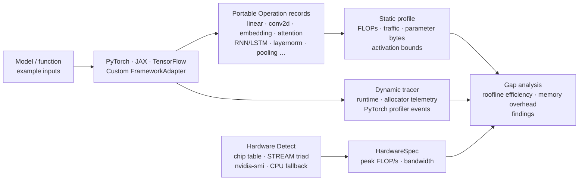

# neural-cost

[](https://pypi.org/project/neural-cost/)
[](https://pypi.org/project/neural-cost/)
[](https://github.com/davidgraymi/neural-cost/actions/workflows/ci.yml)
[](https://opensource.org/licenses/MIT)
[](https://pypi.org/project/neural-cost/)
[](https://github.com/astral-sh/ruff)

[**PyPI Package**](https://pypi.org/project/neural-cost/) • [**Documentation**](https://github.com/davidgraymi/neural-cost#readme) • [**Issue Tracker**](https://github.com/davidgraymi/neural-cost/issues) • [**Releases**](https://github.com/davidgraymi/neural-cost/releases)

`neural-cost` estimates a neural network's useful compute and compulsory tensor
traffic, measures its runtime, and uses a roofline lower bound to highlight
likely optimization opportunities.  It is intentionally framework-neutral at
its core: PyTorch, TensorFlow, and JAX are optional adapters rather than base
dependencies.

## Installation

Install the core package from [PyPI](https://pypi.org/project/neural-cost/):

```bash
pip install neural-cost
```

Or using [`uv`](https://docs.astral.sh/uv/):

```bash
uv add neural-cost
```

### Framework Adapters

Framework adapters are optional extras, keeping `neural-cost` lightweight with zero mandatory external dependencies:

| Framework | Installation Command | Description |
|---|---|---|
| **PyTorch** | `pip install "neural-cost[torch]"` | PyTorch eager execution & FX graph tracer adapter |
| **JAX** | `pip install "neural-cost[jax]"` | JAX primitives and jaxpr tracing |
| **JAX on Apple Silicon (Metal)** | `pip install "neural-cost[jax-metal]"` | Official Apple Metal plugin for JAX GPU acceleration |
| **JAX on Apple Silicon (MPS)** | `pip install "neural-cost[jax-mps]"` | Community MLX backend for Apple Silicon MPS |
| **TensorFlow** | `pip install "neural-cost[tensorflow]"` | TensorFlow / Keras layer adapter |
| **All Frameworks** | `pip install "neural-cost[torch,jax,tensorflow]"` | All supported deep learning framework adapters |
| **Development** | `pip install "neural-cost[dev]"` | Test suite (`pytest`) & code style tools (`ruff`) |

### Development & Source Installation

For local development or running benchmarks directly from the source repository:

```bash
git clone https://github.com/davidgraymi/neural-cost.git
cd neural-cost
pip install -e '.[dev,torch,jax,tensorflow]'
```

## Architecture



## Supported operation kinds

| Kind | Description |
|---|---|
| `linear` | Dense / fully-connected projection |
| `conv2d` | 2-D convolution (NCHW / OIHW) |
| `matmul` | Raw matrix multiply |
| `embedding` | Token embedding lookup (read-only traffic model) |
| `attention` | Multi-head self-attention (QKV projections + softmax + output) |
| `elementwise` | Point-wise ops (ReLU, exp, tanh, …) |
| `softmax` / `layernorm` / `batchnorm` | Normalisation ops |
| `rmsnorm` | Root Mean Square normalisation |
| `swiglu` | Gated linear unit with Swish activation |
| `pooling` | Max / average / global-average pooling |
| `moe` | Mixture-of-Experts sparse routing and expert FFN execution |
| `gather` / `scatter` | Indexed reads and in-place indexed updates; only touched elements count as traffic |
| `custom` | Caller-supplied explicit FLOP count |

Adapters automatically emit the right kind for each layer type:

| Framework | Captured layer types |
|---|---|
| **PyTorch** | `Linear`, `Conv2d`, `Embedding`, `RNN`, `GRU`, `LSTM`, `MultiheadAttention`, `LayerNorm`, `BatchNorm1d/2d` |
| **TensorFlow** | `Dense`, `Conv2D`, `Embedding`, `GRU`, `LSTM`, `MultiHeadAttention`, `BatchNormalization`, `LayerNormalization`, pooling layers |
| **JAX** | `dot_general` (matmul), `conv_general_dilated` (conv2d), elementwise/comparison/reduction primitives, `gather`/`scatter`/`dynamic_slice`/`dynamic_update_slice`, and `scan`/`while`/`cond` bodies |

## Analyze portable operations

```python
from neural_cost import HardwareSpec, Operation, analyze_gap, benchmark, estimate_operations, detect_hardware

ops = [Operation("classifier", "linear", ((32, 768), (768, 1000)), (32, 1000), 2)]
estimate = estimate_operations(ops)
measurement = benchmark(lambda: run_inference(), warmup=5, repeats=20)

# Auto-detect or specify manually:
hardware, info = detect_hardware()
# Or: hardware = HardwareSpec("GPU", peak_flops=312e12, memory_bandwidth=1.6e12)
report = analyze_gap(estimate, measurement, hardware)

print(report.render())
```

The theoretical model reports FLOPs, tensor reads/writes, arithmetic intensity,
and a compute/bandwidth lower bound.  The measured gap is expected: it captures
launch overhead, synchronization, framework behavior, unfused intermediates,
workspaces, caches, and imperfect kernel utilization.

## Explain the gap, not just its size

A roofline efficiency of 4% tells you a workload is slow. It doesn't tell you
why. `neural-cost` goes further in three ways: it checks that every framework
counts the same model the same way, it splits the measured time into its
physical causes, and it publishes out-of-sample error for its predictions on
real hardware.

### 1. Cross-framework consistency you can test

Adapters see a model at different granularity. A PyTorch hook records one
`attention` op, while a JAX trace records the `dot_general`, `exp` and
`reduce_sum` primitives that implement it. `flop_breakdown` separates
granularity-invariant **dense FLOPs** (contractions, 2 FLOPs per MAC) and
**unique parameters** from **auxiliary FLOPs** (point-wise work, which depends
on what the adapter captures). `cross_check` then compares adapters against
their median:

```python
from neural_cost import cross_check
from neural_cost.adapters import JaxAdapter, TensorFlowAdapter, TorchAdapter

report = cross_check({
    "torch": TorchAdapter().operations(torch_model, torch_inputs),
    "jax": JaxAdapter().operations(jax_fn, (x, params)),
    "tensorflow": TensorFlowAdapter().operations(keras_model, tf_inputs),
}, rtol=0.0)
print(report.render())
```

The test suite builds an MLP, an NHWC CNN, a 2-layer `lax.scan` LSTM and
multi-head attention identically in all three frameworks. It asserts that the
dense FLOPs and parameter counts match each other exactly and match
closed-form values (`tests/test_cross_framework.py`). The five reference
architectures in `examples/architecture_comparison.py` also agree exactly. The
JAX tracer recurses into `jit`, `scan` (scaled by trip count), `while`,
`cond` and `custom_jvp`, handles arbitrary `dot_general` contractions and
NHWC convolutions, and tracks parameters through transposes and broadcasts.

### 2. Gap attribution

`attribute_gap` splits measured runtime into ordered, non-overlapping
components that sum exactly to the median:

| Component | What it is |
|---|---|
| `roofline_floor` | FLOPs and fused bytes at datasheet peak with perfect overlap. Nothing can run faster. |
| `unfused_traffic` | Extra DRAM round-trips for intermediates a fusing compiler would keep on chip |
| `serialization` | Lost compute/memory overlap: each op is bounded by its own roofline |
| `peak_derate` | Datasheet peak vs. *measured achievable* throughput, at each op's size |
| `dispatch` | Per-kernel launch overhead (only the part not hidden by async execution) plus per-call sync |
| `kernel_inefficiency` | How much slower each op runs *alone* than its achievable roofline (op replay) |
| `timing_jitter` | Median minus fastest sample |
| `residual` | Composition effects: framework glue, uncaptured ops, cache interference |

```python
from neural_cost import attribute_gap, detect_hardware
from neural_cost.adapters import TorchAdapter

adapter = TorchAdapter(use_profiler=False)            # no profiler overhead in timings
hardware, _ = detect_hardware()
calibration = adapter.calibrate("mps")                 # size-dependent FLOP/s + bandwidth curves,
                                                       # dispatch and sync latency
ops = adapter.operations(model, inputs)
measurement = adapter.benchmark(model, *inputs, repeats=30)
kernels = adapter.trace_kernels(model, inputs)         # every ATen kernel, incl. uncaptured ones

attribution = attribute_gap(
    ops, measurement, hardware, calibration,
    kernel_count=len(kernels),
    extra_kernels=[(k.bytes, k.python_dispatch) for k in kernels if not k.heavy],
    isolated_seconds=adapter.replay(ops, "mps"),       # each op timed alone at its exact shape
    assume_fusion=False,                               # eager execution
)
print(attribution.render())
for step in attribution.recommendations():
    print(step)
```

Calibration measures throughput as a function of size: matmuls from 32² to
4096², and copies from 64 KiB (cache-resident) to 256 MiB (DRAM). Small
kernels and cache-resident data are therefore modeled at the rate they
actually reach. On asynchronous devices (CUDA, MPS) a kernel only exposes
`max(0, dispatch − runtime)` of launch overhead. Kernels issued inside a C++
composite op, such as the per-timestep ops of an eager CPU LSTM, pay no Python
dispatch.

### 3. Published validation

`benchmarks/validate.py` runs a grid of MLP, CNN, LSTM and Transformer
workloads on every installed backend and writes
[`VALIDATION_REPORT.md`](VALIDATION_REPORT.md). It scores three predictors,
and none of them is ever fit to the workload it predicts:

* **Zero-shot**: microbenchmark calibration only. It never sees a model runtime.
* **Op-replay**: each captured op is timed alone with synthetic tensors, then
  the times are composed. It never runs the model.
* **LOO fit**: a 4-parameter non-negative model
  (`T = c₀ + α·kernels + FLOPs/P + bytes/BW`), with each workload predicted
  by a fit on all the others.

It also checks that the roofline is a valid **lower bound**. Any measurement
faster than the bound would falsify the model.

Results on an Apple M3 (`VALIDATION_REPORT.md`, 59 workloads, 3 backends):

| Backend | Bound violations | Zero-shot MAPE (median) | Op-replay MAPE (median) | LOO fit MAPE (median) | Rank corr. (best predictor) |
|---|---:|---:|---:|---:|---:|
| PyTorch eager, CPU | 0 / 23 | 61% (66%) | **26% (22%)** | 51% (52%) | 0.987 |
| PyTorch eager, MPS | 0 / 23 | 29% (19%) | 30% (15%) | **22% (13%)** | 0.948 |
| JAX jit, CPU | 0 / 13 | **39% (33%)** | n/a | 45% (41%) | 0.989 |

What this shows, and what it doesn't. The bound was never violated, and both
bound and predictions rank workloads correctly (Spearman ρ 0.91–0.99). The
best predictor still has a typical (median) error of 13–33%. Most of what remains is the eager-LSTM
decomposition and composition effects that only appear when ops run together.
That is exactly what the `residual` component isolates. The report contains
every per-workload number. Run it on your hardware with:

```bash
python benchmarks/validate.py
```

Building the validation harness surfaced and fixed real bugs: weights were
double-counted in linear/conv traffic, the FX adapter silently dropped
RNN/LSTM/attention layers, and Keras parameter counts included BatchNorm
moving statistics. Recurrent layers also used to be recorded as one big GEMM
instead of T sequential ones. These caused the up-to-6× cross-framework FLOP
discrepancies earlier versions of this README showed.

## Profile static memory and training state

`profile_model` combines FLOP/traffic estimation with parameter and activation
storage bounds.  For training, it also models a parameter-sized gradient buffer
and configurable optimizer state; use `optimizer_state_multiplier=2` for
Adam's two moment buffers.

```python
from neural_cost import profile_model
from neural_cost.adapters import TorchAdapter

profile = profile_model(
    model, inputs, TorchAdapter(), training=True, optimizer_state_multiplier=2
)
print(profile.memory.training_minimum_bytes)
```

The minimum activation bound is the largest output tensor.  The conservative
bound assumes all forward outputs remain live, so real allocator telemetry is
the source of truth for physical VRAM use.

## Mixture-of-Experts (MoE) & Speculative Decoding

`neural-cost` provides specialized theoretical models for modern LLM serving paradigms:

### MoE Sparse Routing & Memory Thrashing

Sparse MoE architectures (e.g. Mixtral, DeepSeek) activate only $k$ of $E$ experts per token. While compute scales with $k$, token-by-token autoregressive decoding requires loading unique experts from DRAM into registers/SRAM, producing severe memory-bandwidth pressure at small batch sizes:

```python
from neural_cost import estimate_moe, analyze_moe_gap, detect_hardware

# Mixtral 8x7B layer: 8 experts, top-2 routing, SwiGLU FFN
est = estimate_moe(
    batch_size=1,
    seq_len=1,
    embed_dim=4096,
    expert_hidden_dim=14336,
    num_experts=8,
    top_k=2,
    expert_type="swiglu",
    is_decode=True,
)

print(f"Total params: {est.total_parameters:,} | Active params: {est.active_parameters:,}")
print(f"Expected loaded experts at B=1: {est.expected_loaded_experts:.1f}")

hardware, _ = detect_hardware()
gap = analyze_moe_gap(est, hardware)
print(gap.render())
```

### Speculative Decoding Breakeven Analysis

Speculative decoding pairs a fast draft model with a parallel target model verification step. `neural-cost` computes the analytical breakeven acceptance rate ($\alpha^*$) required to achieve wall-clock speedup on target hardware:

```python
from neural_cost import (
    CostEstimate,
    detect_hardware,
    estimate_speculative_decoding,
    analyze_speculative_decoding,
)

hardware, _ = detect_hardware()

# Target (70B) vs Draft (1B) step costs
draft_decode = CostEstimate(flops=2e9, read_bytes=2e9, write_bytes=2048, operations=1)
target_verify = CostEstimate(flops=560e9, read_bytes=140e9, write_bytes=16384, operations=1)
target_decode = CostEstimate(flops=140e9, read_bytes=140e9, write_bytes=4096, operations=1)

analysis = analyze_speculative_decoding(
    draft_decode_cost=draft_decode,
    target_verify_cost=target_verify,
    target_decode_cost=target_decode,
    hardware=hardware,
    gamma=4,
    acceptance_rate=0.75,
)

print(analysis.render())
```

Acceptance is rarely uniform: later draft positions are accepted less often, and acceptances are correlated. Pass a per-position profile instead of a scalar, where entry *k* is the probability that draft *k* is accepted given that drafts 1..*k*−1 were. Expected tokens per cycle depend only on these survival probabilities, so this is exact under any correlation. `acceptance_profile_from_lengths` builds the profile from observed accepted-run lengths (e.g. vLLM spec-decode metrics):

```python
from neural_cost import acceptance_profile_from_lengths

profile = acceptance_profile_from_lengths(observed_accepted_lengths, gamma=4)
analysis = analyze_speculative_decoding(
    draft_decode, target_verify, target_decode, hardware, gamma=4, acceptance_rate=profile
)
# analysis.acceptance_rate is the i.i.d. alpha with the same expected tokens/cycle
```

### PagedAttention & KV Cache Memory Modeling

PagedAttention (vLLM) allocates non-contiguous fixed-size blocks (e.g. 16 tokens) to eliminate external fragmentation and over-reservation. `neural-cost` models exact block allocation, compulsory vs wasted fragmentation bytes, prefix cache sharing, and concurrency capacity multipliers:

```python
from neural_cost import estimate_paged_attention, analyze_paged_attention_gap

# 32 concurrent requests with heterogeneous context lengths
context_lens = [256 + (i * 32) for i in range(32)]
paged_cost = estimate_paged_attention(
    batch_size=32,
    context_lens=context_lens,
    embed_dim=4096,
    num_heads=32,
    num_kv_heads=8,  # Grouped-Query Attention (GQA)
    block_size=16,
    num_layers=32,
    max_model_len=4096,
    shared_prefix_tokens=128,  # 128-token shared system prompt
)

gap = analyze_paged_attention_gap(paged_cost)
print(gap.render())
# Reports VRAM saved vs contiguous max reservation, fragmentation ratio, and concurrency gain
```

### Continuous Batching Iteration Cost Simulator

Modern serving engines (vLLM, TGI, TensorRT-LLM) use iteration-level scheduling (continuous/in-flight batching) mixing memory-bound autoregressive decodes and compute-heavy chunked prefills in the same step. `neural-cost` simulates the unified arithmetic intensity and lower-bound execution time across model weights and KV caches:

```python
from neural_cost import (
    estimate_continuous_batch_iteration,
    analyze_continuous_batch_iteration,
    detect_hardware,
)

hardware, _ = detect_hardware()

# Mixed iteration: 64 decode streams + one 512-token chunked prefill
iteration = estimate_continuous_batch_iteration(
    decode_context_lens=[1024] * 64,
    prefill_chunk_lens=[512],
    embed_dim=4096,
    num_heads=32,
    num_kv_heads=8,
    num_layers=32,
    hardware=hardware,
)

gap = analyze_continuous_batch_iteration(iteration, hardware)
print(gap.render())
# Identifies compute vs memory bottleneck and optimal prefill chunk sizing to reach the roofline ridge
```

### State Space Models (Mamba / S6 / SSD) & Linear Attention

State Space Models replace the quadratic $O(L^2)$ attention mechanism and linear-growth $O(L)$ KV cache with a fixed-size $O(1)$ hidden recurrent state ($h_t \in \mathbb{R}^{B \times D_{\text{in}} \times N}$).

`neural-cost` models the associative parallel scan in prefill and constant-memory recurrent step in decode:

```python
from neural_cost import analyze_ssm_gap, detect_hardware, estimate_ssm

# Mamba-3B layer: hidden dim 4096, state dim 16, expand factor 2
est = estimate_ssm(
    batch_size=1,
    seq_len=8192,
    embed_dim=4096,
    state_dim=16,
    expand_factor=2,
    conv_kernel_size=4,
    num_layers=32,
    is_decode=True,
)

print(f"Recurrent state footprint: {est.state_bytes / 1e6:.2f} MB (constant O(1) in seq_len)")
print(
    f"KV cache eliminated: {est.memory_savings_ratio_vs_transformer:.1%} savings vs Transformer KV"
)

hardware, _ = detect_hardware()
gap = analyze_ssm_gap(est, hardware)
print(gap.render())
# Reports constant-memory decode lower bound and throughput advantage over Transformer KV cache retrieval
```

### Distributed 3D Parallelism & Interconnect Rooflines (v0.8.0)

When scaling large models across multi-node clusters, training throughput is governed by the interaction between compute rooflines, network interconnect fabrics, and 3D parallelism strategy.

`neural-cost` models **Tensor Parallelism (TP)**, **Pipeline Parallelism (PP)**, and **Data Parallelism / ZeRO / FSDP** communication volumes, Hockney ($\alpha$-$\beta$) network transfer times, 1F1B schedule bubble fractions, and per-device memory sharding.

- With `activation_checkpointing=True`, the recomputed forward re-issues its TP collectives (`tp_recompute_bytes_per_step`), and step FLOPs are 8×params×tokens instead of 6×.
- `pp_bytes_per_step` is the per-rank volume an interior stage carries; `pp_total_bytes_per_step` sums all `pp_boundaries` stage boundaries across TP ranks and DP replicas. With sequence parallelism each TP rank sends only its 1/TP shard of the boundary tensor. `pp_virtual_stages` models Megatron's interleaved 1F1B schedule, which divides the bubble by *v* and multiplies per-rank PP traffic by *v*.

```python
from neural_cost import (
    ClusterTopology,
    HardwareSpec,
    analyze_distributed_gap,
    estimate_parallelism,
    get_interconnect_preset,
)

# 128x H100 cluster across 16 nodes (8 GPUs per node)
h100 = HardwareSpec(
    "H100", peak_flops=989e12, memory_bandwidth=3.35e12, memory_capacity=80 * 1024**3
)
topo = ClusterTopology(
    device=h100,
    num_nodes=16,
    devices_per_node=8,
    intra_node=get_interconnect_preset("nvlink4"),  # 900 GB/s
    inter_node=get_interconnect_preset("infiniband_ndr"),  # 50 GB/s
)

# Train Llama-3 70B with TP=8, PP=4, DP=4 (ZeRO-3 / FSDP)
cost = estimate_parallelism(
    total_parameters=70_000_000_000,
    batch_size=128,
    seq_len=4096,
    embed_dim=8192,
    num_layers=80,
    tp_degree=8,
    pp_degree=4,
    dp_degree=4,
    num_microbatches=8,
    dp_mode="zero3_fsdp",
)

gap = analyze_distributed_gap(cost, topo, overlap_efficiency=0.85)
print(gap.render())
# Reports MFU, step time, communication overhead, pipeline bubble fraction, and memory fit
```

### Zero-Code Hugging Face Model Ingestion & SVG Roofline Visualizer (v0.10.0)

Profile any open-weight model directly by its Hugging Face repository ID (or local `config.json` path) with **zero external dependencies** and zero PyTorch/Transformers overhead:

```python
from neural_cost import HardwareSpec, from_huggingface, save_roofline_svg, RooflinePoint

# 1. Ingest model architecture directly from Hugging Face Hub (cached locally)
model_cfg = from_huggingface("meta-llama/Meta-Llama-3-8B")
print(f"Architecture: {model_cfg.architecture}, Dim: {model_cfg.embed_dim}, Heads: {model_cfg.num_heads}/{model_cfg.num_kv_heads}")

# 2. Render publication-quality vector SVG roofline charts with workload overlays
hardware = HardwareSpec(name="NVIDIA A100-SXM4-80GB", peak_flops=312e12, memory_bandwidth=2039e9)
point = RooflinePoint(
    arithmetic_intensity=14.2,
    flops=14.2 * hardware.memory_bandwidth,
    label="LLaMA-3-8B Decode (b=1)",
    bottleneck="memory",
    latency_ms=1.1,
)

# Export standalone, responsive vector SVG
save_roofline_svg("llama3_roofline.svg", hardware, points=point, theme="dark")
```

## Hardware detection

Auto-detection via `detect_hardware()` returns a `(HardwareSpec, DetectionResult)` tuple
to determine hardware peak compute and memory bandwidth:

- **Apple Silicon lookup from chip table**: Identifies Apple Silicon chips (M1–M4 series) and looks up published peak FP32 throughput and memory bandwidth.
- **NumPy STREAM-triad bandwidth benchmark**: Measures live effective memory bandwidth using a STREAM Triad kernel (`c = a + scalar * b`).
- **NVIDIA GPU probe via nvidia-smi**: Probes GPU models, clock rates, and bus specs on systems with NVIDIA GPUs.
- **CPU fallback**: Falls back to CPU logical core counts and clock rates when accelerator probes are unavailable.

```python
from neural_cost import detect_hardware

hardware, info = detect_hardware()
print(f"Device: {hardware.device_name} ({info.source})")
print(f"Peak FLOP/s: {hardware.peak_flops / 1e12:.1f} TFLOP/s")
print(f"Bandwidth: {hardware.memory_bandwidth / 1e9:.1f} GB/s")
```

### Device-aware specs

By default `detect_hardware()` describes the fastest detected accelerator.  If
the workload runs on a different device (for example JAX with
`JAX_PLATFORMS=cpu` on an Apple Silicon Mac), pass `device=` so the run is
scored against the right peak:

```python
cpu_spec, _ = detect_hardware(device="cpu")             # skip GPU tables
spec, _ = detect_hardware(device=jax.devices()[0])      # JAX device object
spec, _ = detect_hardware(device=torch.device("mps"))   # torch device
spec, _ = JaxAdapter().hardware()                       # active JAX device
```

Every detected `HardwareSpec` records a `device_type` (`"cpu"` or `"gpu"`).
When an adapter benchmark records the device it ran on, `analyze_gap` adds a
**Device mismatch** finding if the two disagree.  On Apple Silicon the CPU
peak uses a NEON P/E-core table and the CPU shares the chip's unified memory
bandwidth with the GPU.  The CLI accepts the same option:
`neural-cost hardware --device cpu`.

Apple variants are told apart by GPU core count (from `system_profiler`): the
FP32 peak scales with cores, and binned chips get their narrower memory bus
(M3 Max 30-core 300 GB/s vs 40-core 400 GB/s; M4 Max 32-core 410 GB/s vs
40-core 546 GB/s).

### Measuring the peak on the active device

Spec sheets do not cover every backend (jax-mps, jax-metal, TPU, future
plugins), and the achievable peak can sit well below the datasheet. JAX can
measure both peaks on the device itself with a matmul sweep for FLOP/s and a
streaming `x + 1` sweep for bandwidth. Results are cached per device for the
process:

```python
adapter = JaxAdapter()
calibration = adapter.calibrate(device=jax.devices()[0])     # HardwareCalibration
spec = calibration.to_hardware_spec(device_type="gpu")       # score against achievable peaks
calibration.fraction_of(adapter.hardware()[0])               # e.g. (0.81, 0.84) of spec sheet

spec, _ = adapter.hardware()                  # tables, measured fallback if no table entry
spec, _ = adapter.hardware(measure="always")  # always measure on the device
```

```bash
neural-cost hardware --calibrate jax --quick
#   Achievable Compute: 0.440 TFLOP/s (81% of spec)
#   Achievable BW:      57.60 GB/s (84% of spec)
```

## Framework adapters

```python
import torch
from neural_cost import estimate_model
from neural_cost.adapters import TorchAdapter

model = torch.nn.Sequential(torch.nn.Linear(128, 64), torch.nn.ReLU(), torch.nn.Linear(64, 10))
inputs = (torch.randn(16, 128),)
estimate = estimate_model(model, inputs, TorchAdapter())
measurement = TorchAdapter().benchmark(model, *inputs)
```

`TorchAdapter` captures `Linear`, `Conv2d`, `Embedding`, `RNN`, `GRU`, `LSTM`,
`MultiheadAttention`, `LayerNorm`, and `BatchNorm` modules via forward hooks and
synchronizes CUDA benchmarks.  Its `trace` method uses `torch.profiler` and
returns aggregate profiler-event and CUDA allocator statistics.
`TensorFlowAdapter` captures the equivalent Keras layers and returns supported
TensorFlow GPU allocator statistics.  `JaxAdapter` traces `dot_general`,
`conv_general_dilated`, elementwise, comparison and reduction primitives, and
indexing primitives (`gather`, `scatter*`, `dynamic_slice`,
`dynamic_update_slice`), and waits for asynchronous device work during
benchmarks.  All adapters are optional imports:

```python
from neural_cost.adapters import JaxAdapter, TensorFlowAdapter, TorchAdapter
```

`JaxAdapter` recurses into `scan` (scaled by its static length), `cond` (most
expensive branch) and `while_loop`.  A counted `while i < N` loop with literal
bounds is inferred; for data-dependent loops (tree search, environment
rollouts) supply the trip count:

```python
adapter = JaxAdapter(trip_counts={0: 16}, default_trip_count=8)
ops = adapter.operations(search_fn, (obs, params))
adapter.while_trip_counts  # [(16, "user"), (8, "default"), ...] in trace order
```

### Coverage: how much of the workload the roofline describes

Bounds and efficiencies only describe the operations an adapter understood.
After `operations()`, `JaxAdapter` (jaxpr equations) and `TorchAdapter`
(executed leaf modules) record a `Coverage`. Pass it to `analyze_gap`, or use
`profile_model` + `analyze_model_gap`, which pass it for you:

```python
adapter = JaxAdapter()
ops = adapter.operations(fn, (obs, params))
gap = analyze_gap(estimate_operations(ops), adapter.benchmark(fn, obs, params),
                  hardware, operations=ops, coverage=adapter.coverage)
print(gap.render())
# Neural cost gap analysis
#   coverage: 41.2% of 340 equations modeled (unmodeled: sort x12, threefry2x32 x8, ...)
#   WARNING: Low coverage: only 41.2% of the traced equations were modeled; ...
```

`Coverage.unmodeled_primitives` lists skipped primitives by frequency, and
`unmodeled_output_bytes` sums their output sizes as a rough measure of the
traffic left out. The warning threshold defaults to 90%
(`analyze_gap(..., coverage_threshold=0.8)`).

### Per-operation breakdown

When `analyze_gap` receives `operations=`, `render()` includes a table of
the top operations. Choose how many rows (`top`) and the sort key
(`"share"` of the lower bound, `"bytes"` or `"flops"`). `JaxAdapter` prefixes
operation names with their name scope (`jax.named_scope`, Flax module
names), and `group_by_scope=True` sums each scope, which shows whether
normalization layers or convolutions drive the traffic:

```python
print(gap.render(top=5, group_by_scope=True))
#   top 5 of 6 scopes by share of lower bound:
#      #  operation                  kind         FLOPs        bytes   FLOP/B      bound   share  regime
#      1  model/block_0/Conv_0       conv2d       604.0 MFLOP  4.3 MB  139.11   1.116 ms   36.1%  compute
#      3  model/block_0/GroupNorm_0  elementwise  3.7 MFLOP   25.2 MB    0.15   0.369 ms   11.9%  memory
```

Group and layer norms lowered to reductions plus elementwise ops are traced in
full. Reductions count one FLOP per input element.

## Pipeline profiling

Real workloads are pipelines. One self-play search is tree bookkeeping plus
N environment steps plus N network forwards. `Pipeline` benchmarks each stage,
scales it by its call count, and compares the sum with an end-to-end
measurement. The difference is reported as unexplained time (dispatch, loop
overhead, transfers):

```python
from neural_cost import Pipeline, Stage
from neural_cost.adapters import JaxAdapter

pipeline = Pipeline(
    {
        "tree": Stage(tree_update, (tree, stats)),
        "env": Stage(env_step, (state, action), calls=16),
        "net": (net_apply, (params, obs), 16),        # tuple shorthand
    },
    total=Stage(search, (params, state)),
)
adapter = JaxAdapter()
report = pipeline.run(adapter=adapter, hardware=adapter.hardware()[0])
print(report.render())
# Pipeline profile (measured total 614.000 ms on mps:0)
#   stage         calls     per call        total    share  roofline
#   tree              1   300.000 ms   300.000 ms    48.9%  12.0% (memory-bound), 38% coverage
#   env              16    11.625 ms   186.000 ms    30.3%  ...
#   net              16     5.688 ms    91.000 ms    14.8%  68.9% (memory-bound), 100% coverage
#   unexplained                         37.000 ms     6.0%  dispatch / loop overhead
```

With `hardware=`, each stage also gets its own roofline `GapAnalysis`
(`report.stages[i].gap`), traced by the adapter or taken from
`Stage(operations=...)`. From the shell, point the CLI at a `Pipeline` or a
function that returns one:

```bash
neural-cost pipeline selfplay.py:build_pipeline --framework jax --roofline
neural-cost pipeline selfplay.py:build_pipeline --framework jax --json
```

## E2E architecture comparison

Run the architecture comparison script to benchmark five canonical neural
network families side-by-side across all installed frameworks:

```bash
pip install "neural-cost[torch,jax,tensorflow]"
# Or from local editable checkout:
# pip install -e '.[torch,jax,tensorflow]'
python examples/architecture_comparison.py
```

The script evaluates **FF DNN**, **CNN**, **RNN**, **LSTM**, and **Transformer**
architectures using a shared hidden dimension (128) and batch size (16).
Hardware is auto-detected; pass `--peak-flops` / `--memory-bandwidth` to override.

## GPU benchmark

Run the GPU benchmark to evaluate the same five architectures on available GPU
accelerators (CUDA, ROCm, MPS, or CPU fallback):

```bash
# Auto-detect GPU (CUDA → MPS → CPU fallback)
python benchmarks/collect_gpu_data.py

# Quick run (fewer batch sizes / repeats)
python benchmarks/collect_gpu_data.py --quick

# Explicit CUDA device
python benchmarks/collect_gpu_data.py --device cuda

# Apple Silicon GPU
python benchmarks/collect_gpu_data.py --device mps

# Override hardware specs (e.g. NVIDIA A100 80 GB)
python benchmarks/collect_gpu_data.py \
  --peak-flops 312e12 --memory-bandwidth 2.0e12
```

Results are written to `benchmarks/results/benchmark_gpu_data.json`.
Generate figures and the full markdown report:

```bash
python benchmarks/generate_gpu_report.py
# → GPU_BENCHMARK_REPORT.md + benchmarks/results/figures/gpu_fig*.png
```

### GPU-vs-CPU crossover analysis

Find the exact batch size at which each architecture first runs faster on GPU than CPU:

```bash
# Collect CPU baseline first (if not already done)
python benchmarks/collect_data.py

# Run GPU benchmark with the fine batch-size grid (1, 4, 8 … 1024)
python benchmarks/collect_gpu_data.py --crossover

# Regenerate report — Figure GPU-8 (crossover plot) will now be included
python benchmarks/generate_gpu_report.py
```

The crossover analysis sweeps `CROSSOVER_BATCH_SIZES = [1, 4, 8, 16, 32, 64, 128, 256, 512, 1024]`
and prints a table showing the first batch at which GPU latency drops below CPU latency.

### JAX on Apple Silicon (MPS / Metal)

JAX requires an explicit GPU plugin to run on Apple Silicon GPUs.
**Without a plugin, JAX silently falls back to CPU** even on MPS-capable machines.
Install one of:

```bash
# Official Apple plugin via package extra:
pip install "neural-cost[jax-metal]"
# or directly:
pip install jax-metal

# Community MLX backend via package extra (set JAX_PLATFORMS=mps):
pip install "neural-cost[jax-mps]"
# or directly:
pip install jax-mps && JAX_PLATFORMS=mps python benchmarks/collect_gpu_data.py
```

The benchmark now detects whether a plugin is installed and emits a clear diagnostic
when JAX is running on CPU instead of the GPU.

Known JAX MPS limitations (tracked upstream):
- `jax.jit()` **regresses CNN latency 3×** on MPS — XLA's Metal conv lowering inserts
  extra memory-layout transposes for statically-shaped graphs (known bug).
- `jax.jit()` gains are large for LSTM (+1.79×) and Transformer (+1.12×) where XLA
  eliminates intermediate tensor roundtrips.

### GPU vs CPU benchmark differences

| Aspect | CPU benchmark | GPU benchmark |
|---|---|---|
| Timing | `time.perf_counter_ns` | CUDA events (`torch.cuda.Event`) |
| Sync barrier | None (CPU executes synchronously) | `torch.cuda.synchronize()` / `block_until_ready()` |
| TF optimised variant | `tf.function` (no XLA) | `tf.function(jit_compile=True)` (XLA GPU) |
| Batch sizes | 1, 8, 32, 128 | 8, 32, 128, 512 |
| Device placement | CPU tensors | `.to(device)` / `jax.device_put` / `tf.device` |

<details>
<summary>Sample output (Apple M3, 3.6 TFLOP/s · 100 GB/s, batch=16, seq=32)</summary>

```
┌─ Hardware ──────────────────────────────────────────────────────────────────
│  Device          : Apple M3
│  Peak FP32       : 3.60 TFLOP/s
│  Peak bandwidth  : 100.0 GB/s  (STREAM triad: 51.6 GB/s)
│  Ridge point     : 36.0 FLOP/byte
│  Detection source: Apple Silicon table (Apple M3) [FP32] + NumPy STREAM triad
└────────────────────────────────────────────────────────────────────────────

Benchmarking PyTorch…
    FF DNN         0.05 ms  11.8% eff
    CNN            4.83 ms  8.4% eff
    RNN            0.78 ms  8.2% eff
    LSTM           2.43 ms  9.3% eff
    Transformer    1.30 ms  13.3% eff
Benchmarking JAX…
    FF DNN         0.08 ms  11.3% eff
    CNN            1.89 ms  31.9% eff
    RNN            1.00 ms  13.1% eff
    LSTM           3.71 ms  15.3% eff
    Transformer    2.41 ms  21.3% eff
Benchmarking TensorFlow…
    FF DNN         1.89 ms  0.3% eff
    CNN            4.21 ms  6.6% eff
    RNN            19.94 ms  0.3% eff
    LSTM           34.28 ms  0.7% eff
    Transformer    11.91 ms  1.0% eff


━━━━━━━━━━━━━━━━━━━━━━━━━━━━━━━━━━━━━━━━━━━━━━━━━━━━━━━━━━━━━━━━━━━━━━━━━━━━━━━━━━━━━━━━━━━━━━━━━━━━━━━━━━━━━━━━━━━━━━━━━━━━━━━━━━━━━━━
  FF DNN
━━━━━━━━━━━━━━━━━━━━━━━━━━━━━━━━━━━━━━━━━━━━━━━━━━━━━━━━━━━━━━━━━━━━━━━━━━━━━━━━━━━━━━━━━━━━━━━━━━━━━━━━━━━━━━━━━━━━━━━━━━━━━━━━━━━━━━━
Framework         FLOPs    Param B    I/O MB      AI   ms(med)     ±ms   effic.       roofline         GFLOP/s     GB/s bound   
───────────────────────────────────────────────────────────────────────────────────────────────────────────────────────────────────────
PyTorch            3.8M    475,176       0.6    6.09     0.053   0.010    11.8% [██░░░░░░░░░░░░░░░░]     71.61    11.76 memory  
JAX                3.8M    475,176       0.9    4.45     0.076   0.005    11.3% [██░░░░░░░░░░░░░░░░]     50.03    11.25 memory  
TensorFlow         3.8M    475,176       0.6    6.42     1.894   0.101     0.3% [░░░░░░░░░░░░░░░░░░]      2.00     0.31 memory  
───────────────────────────────────────────────────────────────────────────────────────────────────────────────────────────────────────
  Diagnostics (top layer bottleneck & fusion):
    • PyTorch: Top Bottleneck: _0 (linear, memory-bound) (73.7%), Fused Eff: 10.5%, Resident in SLC
    • JAX: Top Bottleneck: dot_1 (matmul, memory-bound) (53.7%), Fused Eff: 8.2%, Resident in SLC
    • TensorFlow: Top Bottleneck: dense (linear, memory-bound) (77.8%), Fused Eff: 0.3%, Resident in SLC
───────────────────────────────────────────────────────────────────────────────────────────────────────────────────────────────────────
  AI = arithmetic intensity (FLOP/byte).  Ridge point = 36.0 FLOP/byte  (above → compute-bound, below → memory-bound)

━━━━━━━━━━━━━━━━━━━━━━━━━━━━━━━━━━━━━━━━━━━━━━━━━━━━━━━━━━━━━━━━━━━━━━━━━━━━━━━━━━━━━━━━━━━━━━━━━━━━━━━━━━━━━━━━━━━━━━━━━━━━━━━━━━━━━━━
  CNN
━━━━━━━━━━━━━━━━━━━━━━━━━━━━━━━━━━━━━━━━━━━━━━━━━━━━━━━━━━━━━━━━━━━━━━━━━━━━━━━━━━━━━━━━━━━━━━━━━━━━━━━━━━━━━━━━━━━━━━━━━━━━━━━━━━━━━━━
Framework         FLOPs    Param B    I/O MB      AI   ms(med)     ±ms   effic.       roofline         GFLOP/s     GB/s bound   
───────────────────────────────────────────────────────────────────────────────────────────────────────────────────────────────────────
PyTorch          671.1M    309,288      40.4   16.63     4.829   0.094     8.4% [██░░░░░░░░░░░░░░░░]    138.97     8.36 memory  
JAX              666.9M    309,288      60.3   11.06     1.890   0.017    31.9% [██████░░░░░░░░░░░░]    352.90    31.91 memory  
TensorFlow       670.1M    309,288      27.8   24.12     4.207   0.108     6.6% [█░░░░░░░░░░░░░░░░░]    159.26     6.60 memory  
───────────────────────────────────────────────────────────────────────────────────────────────────────────────────────────────────────
  Diagnostics (top layer bottleneck & fusion):
    • PyTorch: Top Bottleneck: _4 (conv2d, compute-bound) (31.2%), Fused Eff: 3.9%
    • JAX: Top Bottleneck: conv_10 (conv2d, compute-bound) (22.8%), Fused Eff: 9.8%
    • TensorFlow: Top Bottleneck: conv2d_1 (conv2d, compute-bound) (40.8%), Fused Eff: 4.4%
───────────────────────────────────────────────────────────────────────────────────────────────────────────────────────────────────────
  AI = arithmetic intensity (FLOP/byte).  Ridge point = 36.0 FLOP/byte  (above → compute-bound, below → memory-bound)

━━━━━━━━━━━━━━━━━━━━━━━━━━━━━━━━━━━━━━━━━━━━━━━━━━━━━━━━━━━━━━━━━━━━━━━━━━━━━━━━━━━━━━━━━━━━━━━━━━━━━━━━━━━━━━━━━━━━━━━━━━━━━━━━━━━━━━━
  RNN
━━━━━━━━━━━━━━━━━━━━━━━━━━━━━━━━━━━━━━━━━━━━━━━━━━━━━━━━━━━━━━━━━━━━━━━━━━━━━━━━━━━━━━━━━━━━━━━━━━━━━━━━━━━━━━━━━━━━━━━━━━━━━━━━━━━━━━━
Framework         FLOPs    Param B    I/O MB      AI   ms(med)     ±ms   effic.       roofline         GFLOP/s     GB/s bound   
───────────────────────────────────────────────────────────────────────────────────────────────────────────────────────────────────────
PyTorch           67.1M    267,304       6.4   10.43     0.784   0.007     8.2% [█░░░░░░░░░░░░░░░░░]     85.63     8.21 memory  
JAX               67.4M    267,304      13.1    5.14     1.003   0.013    13.1% [██░░░░░░░░░░░░░░░░]     67.22    13.09 memory  
TensorFlow        67.1M    267,304       6.6   10.22    19.936   0.280     0.3% [░░░░░░░░░░░░░░░░░░]      3.37     0.33 memory  
───────────────────────────────────────────────────────────────────────────────────────────────────────────────────────────────────────
  Diagnostics (top layer bottleneck & fusion):
    • PyTorch: Top Bottleneck: rnn.layer0.hh (linear, memory-bound) (40.7%), Resident in SLC
    • JAX: Top Bottleneck: dot_4 (matmul, memory-bound) (20.0%), Fused Eff: 13.0%
    • TensorFlow: Top Bottleneck: simple_rnn.hh (linear, memory-bound) (39.9%), Resident in SLC
───────────────────────────────────────────────────────────────────────────────────────────────────────────────────────────────────────
  AI = arithmetic intensity (FLOP/byte).  Ridge point = 36.0 FLOP/byte  (above → compute-bound, below → memory-bound)

━━━━━━━━━━━━━━━━━━━━━━━━━━━━━━━━━━━━━━━━━━━━━━━━━━━━━━━━━━━━━━━━━━━━━━━━━━━━━━━━━━━━━━━━━━━━━━━━━━━━━━━━━━━━━━━━━━━━━━━━━━━━━━━━━━━━━━━
  LSTM
━━━━━━━━━━━━━━━━━━━━━━━━━━━━━━━━━━━━━━━━━━━━━━━━━━━━━━━━━━━━━━━━━━━━━━━━━━━━━━━━━━━━━━━━━━━━━━━━━━━━━━━━━━━━━━━━━━━━━━━━━━━━━━━━━━━━━━━
Framework         FLOPs    Param B    I/O MB      AI   ms(med)     ±ms   effic.       roofline         GFLOP/s     GB/s bound   
───────────────────────────────────────────────────────────────────────────────────────────────────────────────────────────────────────
PyTorch          268.5M       1.1M      22.6   11.90     2.432   0.007     9.3% [██░░░░░░░░░░░░░░░░]    110.38     9.27 memory  
JAX              270.2M       1.1M      56.6    4.77     3.705   0.024    15.3% [███░░░░░░░░░░░░░░░]     72.92    15.29 memory  
TensorFlow       268.5M       1.1M      23.1   11.63    34.282   0.362     0.7% [░░░░░░░░░░░░░░░░░░]      7.83     0.67 memory  
───────────────────────────────────────────────────────────────────────────────────────────────────────────────────────────────────────
  Diagnostics (top layer bottleneck & fusion):
    • PyTorch: Top Bottleneck: lstm.layer0.hh (linear, memory-bound) (41.9%)
    • JAX: Top Bottleneck: dot_4 (matmul, memory-bound) (17.1%), Fused Eff: 15.2%
    • TensorFlow: Top Bottleneck: lstm.hh (linear, memory-bound) (41.9%)
───────────────────────────────────────────────────────────────────────────────────────────────────────────────────────────────────────
  AI = arithmetic intensity (FLOP/byte).  Ridge point = 36.0 FLOP/byte  (above → compute-bound, below → memory-bound)

━━━━━━━━━━━━━━━━━━━━━━━━━━━━━━━━━━━━━━━━━━━━━━━━━━━━━━━━━━━━━━━━━━━━━━━━━━━━━━━━━━━━━━━━━━━━━━━━━━━━━━━━━━━━━━━━━━━━━━━━━━━━━━━━━━━━━━━
  Transformer
━━━━━━━━━━━━━━━━━━━━━━━━━━━━━━━━━━━━━━━━━━━━━━━━━━━━━━━━━━━━━━━━━━━━━━━━━━━━━━━━━━━━━━━━━━━━━━━━━━━━━━━━━━━━━━━━━━━━━━━━━━━━━━━━━━━━━━━
Framework         FLOPs    Param B    I/O MB      AI   ms(med)     ±ms   effic.       roofline         GFLOP/s     GB/s bound   
───────────────────────────────────────────────────────────────────────────────────────────────────────────────────────────────────────
PyTorch          422.2M       1.6M      17.3   24.37     1.302   0.014    13.3% [██░░░░░░░░░░░░░░░░]    324.40    13.31 memory  
JAX              423.6M       1.6M      51.4    8.24     2.407   0.021    21.3% [████░░░░░░░░░░░░░░]    175.95    21.34 memory  
TensorFlow       421.4M       1.6M      10.0   42.19    11.910   0.054     1.0% [░░░░░░░░░░░░░░░░░░]     35.38     0.84 compute 
───────────────────────────────────────────────────────────────────────────────────────────────────────────────────────────────────────
  Diagnostics (top layer bottleneck & fusion):
    • PyTorch: Top Bottleneck: attn1 (attention, compute-bound) (10.0%), Fused Eff: 9.0%
    • JAX: Top Bottleneck: add_54 (elementwise, memory-bound) (4.0%), Fused Eff: 8.5%
    • TensorFlow: Top Bottleneck: multi_head_attention (attention, compute-bound) (15.3%), Fused Eff: 1.0%
───────────────────────────────────────────────────────────────────────────────────────────────────────────────────────────────────────
  AI = arithmetic intensity (FLOP/byte).  Ridge point = 36.0 FLOP/byte  (above → compute-bound, below → memory-bound)

━━━━━━━━━━━━━━━━━━━━━━━━━━━━━━━━━━━━━━━━━━━━━━━━━━━━━━━━━━━━━━━━━━━━━━━━━━━━━━━━━━━━━━━━━━━━━━━━━━━━━━━━━━━━━━━━━━━━━━━━━━━━━━━━━━━━━━━
  Per-Architecture × Per-Framework Summary
━━━━━━━━━━━━━━━━━━━━━━━━━━━━━━━━━━━━━━━━━━━━━━━━━━━━━━━━━━━━━━━━━━━━━━━━━━━━━━━━━━━━━━━━━━━━━━━━━━━━━━━━━━━━━━━━━━━━━━━━━━━━━━━━━━━━━━━
  Architecture    PyTorch                       JAX                           TensorFlow                  
  ────────────────────────────────────────────────────────────────────────────────────────────────────────
  FF DNN          11.8% eff  0.05ms  3.8M FLOPs  11.3% eff  0.08ms  3.8M FLOPs  0.3% eff  1.89ms  3.8M FLOPs
  CNN             8.4% eff  4.83ms  671.1M FLOPs  31.9% eff  1.89ms  666.9M FLOPs  6.6% eff  4.21ms  670.1M FLOPs
  RNN             8.2% eff  0.78ms  67.1M FLOPs  13.1% eff  1.00ms  67.4M FLOPs  0.3% eff  19.94ms  67.1M FLOPs
  LSTM            9.3% eff  2.43ms  268.5M FLOPs  15.3% eff  3.71ms  270.2M FLOPs  0.7% eff  34.28ms  268.5M FLOPs
  Transformer     13.3% eff  1.30ms  422.2M FLOPs  21.3% eff  2.41ms  423.6M FLOPs  1.0% eff  11.91ms  421.4M FLOPs

  *Efficiency >100% means hardware spec is conservative; pass --peak-flops to calibrate.

  Canonical cross-framework consistency (dense FLOPs, unique parameters)
  FF DNN             3.8M dense FLOPs    118,794 params  identical
  CNN              660.6M dense FLOPs     77,322 params  identical
  RNN               67.1M dense FLOPs     66,826 params  identical
  LSTM             268.5M dense FLOPs    263,434 params  identical
  Transformer      419.5M dense FLOPs    397,834 params  identical
```

> **Reading the table**
> Every framework now reports identical dense FLOPs and parameters for each
> architecture (last block); the small differences in the total FLOPs column are
> auxiliary point-wise work that each adapter captures at different granularity.
> All architectures are memory-bound on this device (AI < ridge point of 36 FLOP/byte).
> JAX runs under `jax.jit` (one fused XLA program) and PyTorch in eager mode;
> TensorFlow runs eagerly, so Python dispatch dominates at this batch size,
> especially for sequential (RNN/LSTM) workloads. Use `attribute_gap` to see how
> much of each gap is dispatch, unfused traffic, or kernel inefficiency.

</details>

## Matrix-multiply workload comparison (original)

For a quick cross-framework sanity check on plain matmul shapes, run:

```bash
pip install "neural-cost[torch,jax,tensorflow]"
# Or from local editable checkout:
# pip install -e '.[torch,jax,tensorflow]'
python examples/compare_frameworks.py
```

Optional overrides with known hardware specs:

```bash
python examples/compare_frameworks.py --peak-flops 312e12 --memory-bandwidth 1.6e12
```

## Custom frameworks

Subclass `FrameworkAdapter` and implement `operations(model, example_inputs)`
to return portable `Operation` records.  The adapter can also override
`benchmark` to synchronize an accelerator or collect framework-specific memory
statistics.  This contract keeps model extraction separate from the framework-
independent estimator and analyzer.

## CLI Suite

`neural-cost` provides a unified command-line suite for hardware detection, theoretical profiling, empirical benchmarking, LLM serving analysis, and CI/CD budget assertions:

```bash
# General help and subcommands:
neural-cost --help
```

### 1. Hardware Detection & STREAM Benchmark

Probe attached accelerators, lookup Apple Silicon / NVIDIA published specs, and measure live NumPy STREAM memory bandwidth:

```bash
# Live probe with memory bandwidth benchmark:
neural-cost hardware

# Instant detection without STREAM benchmark:
neural-cost hardware --no-bench

# Machine-readable JSON output:
neural-cost hardware --json

# Describe the CPU even when a GPU is present:
neural-cost hardware --device cpu
```

### 2. Static Architecture Profiling

Compute forward FLOPs, parameter counts, KV cache size, activation memory, arithmetic intensity, and theoretical latency floor on detected or target hardware:

```bash
# Zero-code profiling directly by Hugging Face Hub Model ID:
neural-cost profile meta-llama/Meta-Llama-3-8B

# Ingest Mixtral 8x7B MoE and export publication-ready SVG roofline:
neural-cost profile mistralai/Mixtral-8x7B-v0.1 --plot mixtral_roofline.svg --plot-theme dark

# Profile a 7B Transformer (Llama-style) at batch size 8:
neural-cost profile --arch transformer --batch-size 8 --seq-len 4096 --embed-dim 4096 --num-heads 32 --num-kv-heads 8 --num-layers 32 --dtype fp16

# Profile a quantized 70B Transformer with W4A16 AWQ and launch floor:
neural-cost profile --arch transformer --num-layers 80 --embed-dim 8192 --num-heads 64 --quantization w4a16_awq --num-kernels 640

# Profile training pass with selective activation checkpointing and Adam moments:
neural-cost profile --arch transformer --batch-size 4 --seq-len 4096 --embed-dim 4096 --num-layers 32 --checkpointing selective --training

# Profile an 8x7B Mixture-of-Experts layer:
neural-cost profile --arch moe --num-experts 8 --top-k 2 --embed-dim 4096 --expert-hidden-dim 14336 --decode

# Profile PagedAttention KV cache with shared prefix caching:
neural-cost profile --arch paged-attention --batch-size 32 --seq-len 2048 --block-size 16 --shared-prefix-tokens 128

# Profile State Space Model (Mamba) recurrent state and constant memory:
neural-cost profile --arch ssm --batch-size 1 --seq-len 4096 --embed-dim 4096 --num-layers 32
```

### 3. Empirical Benchmarking

Benchmark real execution latency, achieved compute throughput (GFLOP/s), achieved DRAM bandwidth (GB/s), and roofline efficiency on your local machine:

```bash
# Microbenchmark matrix multiplication:
neural-cost benchmark --arch linear --batch-size 64 --in-features 1024 --out-features 1024

# Benchmark MoE decode step:
neural-cost benchmark --arch moe --batch-size 1 --num-experts 8 --top-k 2

# Benchmark PagedAttention kernel:
neural-cost benchmark --arch paged-attention --batch-size 32 --seq-len 1024 --block-size 16

# Benchmark live NumPy STREAM memory bandwidth:
neural-cost benchmark --arch stream
```

### 4. CI Budget Gate (`audit`)

Enforce automated performance budgets and VRAM ceilings in your CI/CD pipelines. Exits with status `0` if all assertions pass, or `1` if any budget is exceeded:

```bash
# Audit any Hugging Face model directly in CI against strict VRAM and latency bounds:
neural-cost audit meta-llama/Meta-Llama-3-8B --max-vram 16GB --max-latency-ms 25.0

# Fail CI if model exceeds 16GB VRAM or 50ms latency floor:
neural-cost audit \
    --arch transformer \
    --batch-size 1 \
    --seq-len 2048 \
    --embed-dim 4096 \
    --num-heads 32 \
    --num-layers 32 \
    --max-vram 16GB \
    --max-latency-ms 50.0

# JSON output for CI pipeline reporting:
neural-cost audit --arch mlp --in-features 1024 --out-features 1024 --max-vram 1GB --json
```

### 5. Modern LLM Serving Primitives (`llm`)

Dedicated analytical calculators for production serving architectures:

```bash
# Mixture-of-Experts routing & memory traffic:
neural-cost llm moe --batch-size 1 --num-experts 8 --top-k 2 --decode

# Speculative decoding analytical breakeven solver:
neural-cost llm speculative --gamma 4 --acceptance-rate 0.75

# PagedAttention KV cache capacity and fragmentation:
neural-cost llm paged --batch-size 32 --context-len 2048 --block-size 16

# Continuous batching mixed iteration cost simulator:
neural-cost llm continuous --decode-streams 64 --prefill-tokens 512

# State Space Model (Mamba/S6/SSD) recurrent cost and KV elimination analyzer:
neural-cost llm ssm --batch-size 1 --seq-len 32768 --embed-dim 4096 --num-layers 32 --decode

# Sub-byte quantization and dequantization ALU unpacking tax (AWQ, GPTQ, FP8, NVFP4):
neural-cost llm quant --batch-size 1 --in-features 4096 --out-features 4096 --quantization w4a16_awq

# Kernel launch floor & CUDA Graph / torch.compile speedup analyzer:
neural-cost llm launch-floor --num-kernels 640 --arithmetic-floor-ms 0.5 --launch-overhead-us 5.0 --measured-latency-ms 3.5

# Activation checkpointing & selective recomputation (none, full, selective) analyzer:
neural-cost llm checkpointing --strategy selective --batch-size 4 --seq-len 4096 --embed-dim 4096 --vram-gb 80.0
```

### 6. Multi-Framework Comparison (`compare`)

Run head-to-head empirical benchmarks across PyTorch, JAX, and TensorFlow (backward-compatible with `neural-cost-compare`):

```bash
# Multi-framework benchmark runner:
neural-cost compare
# Or using the legacy binary:
neural-cost-compare --warmup 10 --repeats 30
```

### 7. Distributed Cluster & 3D Parallelism (`distributed`)

Model cluster scaling efficiency, network communication volume, and MFU for frontier models:

```bash
# Model Llama-3 70B training across 16 nodes of 8x H100 with TP=8, PP=4, DP=4:
neural-cost distributed \
    --parameters 70e9 \
    --batch-size 128 \
    --seq-len 4096 \
    --embed-dim 8192 \
    --num-layers 80 \
    --num-nodes 16 \
    --devices-per-node 8 \
    --tp 8 \
    --pp 4 \
    --dp 4 \
    --microbatches 8 \
    --dp-mode zero3_fsdp \
    --intra-node nvlink4 \
    --inter-node infiniband_ndr

# Output cluster performance and communication breakdown as JSON:
neural-cost distributed --parameters 7e9 --batch-size 32 --tp 2 --dp 4 --json
```

## Current scope

The package profiles concrete-shape dense, matrix-multiply, convolution,
embedding lookup, multi-head attention, and common elementwise inference graphs,
alongside `softmax`, `layernorm`, `batchnorm`, and `pooling`.  Recurrent layers
(RNN, GRU, LSTM) are modelled as one input→hidden GEMM over all timesteps plus
T sequential hidden→hidden GEMMs.  The published validation covers single-device
eager PyTorch (CPU, MPS) and jitted JAX on one Apple M3; CUDA results come from
running `benchmarks/validate.py` on such a machine, and the analytical
LLM-serving and distributed models (MoE, paged attention, continuous batching,
3D parallelism) are not yet validated against measured systems.  Static training storage includes gradients
and optimizer state but does not yet trace a full backward graph.  Activation
checkpointing, distributed communication, dynamic shapes, fusion details,
complete graph coverage, and non-PyTorch kernel-level traces remain deliberate
next increments rather than silently approximated.

## Development

Format and lint the codebase with a single command:

```bash
# Auto-format and fix linting in place:
python scripts/format.py
# Or using the shell wrapper:
./scripts/format.sh
# Or via Make:
make format

# Check formatting and linting without modifying files:
python scripts/format.py --check
# Or:
make check
```

## Automated Semantic Versioning & Release Pipeline

`neural-cost` uses an automated semantic versioning and release pipeline in GitHub Actions (`.github/workflows/ci.yml` and `.github/workflows/publish.yml`) powered by [`paulhatch/semantic-version`](https://github.com/paulhatch/semantic-version) with path filtering and PyPI trusted publishing.

Version upgrades are determined strictly by Conventional Commits that modify files in the distributed library (`src/`, `pyproject.toml`):

| Change Kind | Commit Conventional Type | Affects Library (`src/`)? | Version Increment | Release Action |
|---|---|---|---|---|
| **Breaking change** | `feat!:`, `fix!:`, `BREAKING CHANGE:` | ✅ Yes | **Major** (`X.0.0`) | Create tag & publish PyPI release |
| **New feature** | `feat:`, `feat(scope):` | ✅ Yes | **Minor** (`0.X.0`) | Create tag & publish PyPI release |
| **Bug fix / performance** | `fix:`, `perf:`, `refactor:` | ✅ Yes | **Patch** (`0.0.X`) | Create tag & publish PyPI release |
| **Non-library changes** | `docs:`, `chore:`, `ci:`, `test:`, benchmarks, workflows | ❌ No | **None** (unchanged) | No tag created; PyPI publish skipped |
| **Doc updates to library** | `docs:`, `style:` (docstrings only) | ✅ Yes | **None** (unchanged) | No tag created; PyPI publish skipped |

- **In CI (PRs)**: The `semver-check` workflow job automatically analyzes commits and library paths in the PR and prints a summary indicating whether a version bump is required and what the new version will be.
- **On Push to `main`**: The `publish` workflow triggers on changes to `src/**` or `pyproject.toml`. If a version increment is detected, it automatically creates and pushes the git tag, generates the GitHub Release, builds sdist & wheel, and publishes to PyPI.


