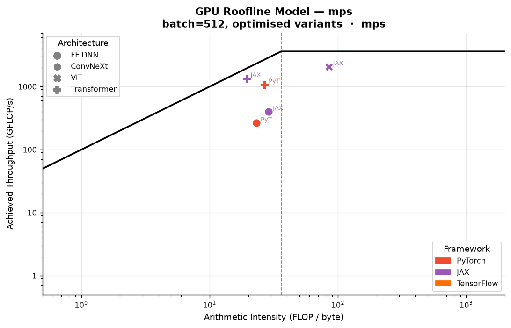
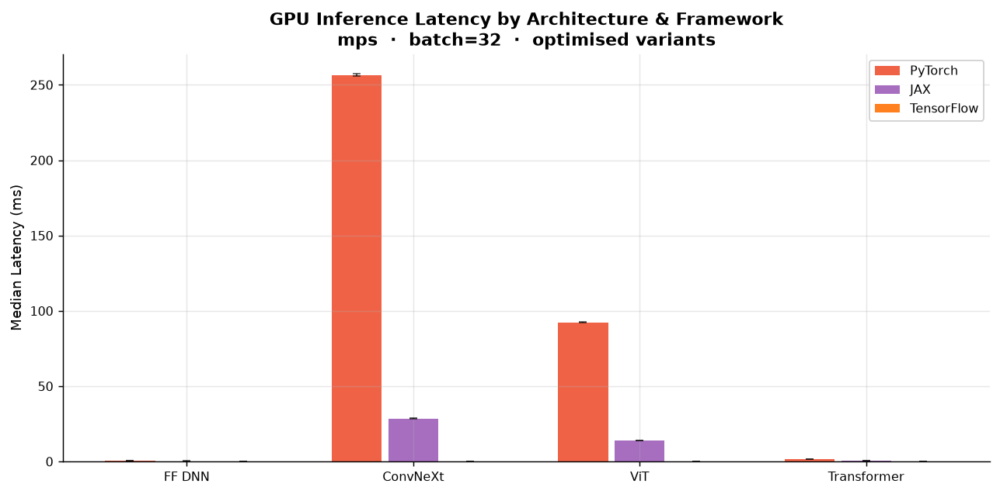
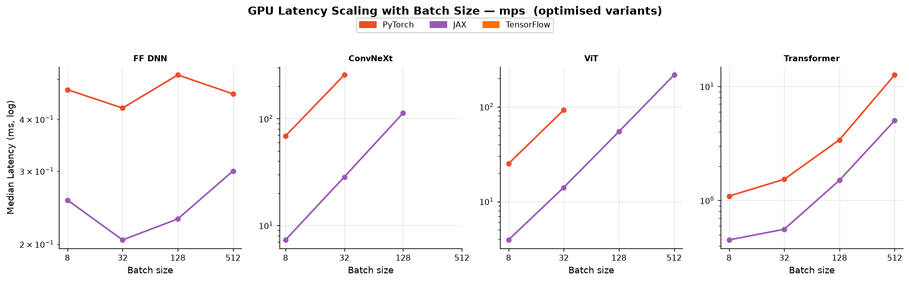
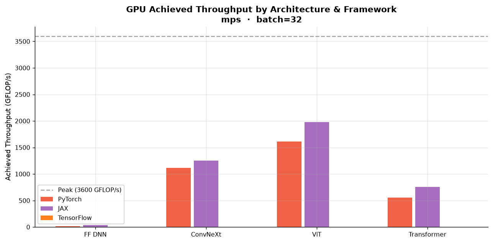

# Neural-Cost GPU Benchmark Report

> **Run:** neural-cost v0.13.0-18-gcb36a1c-dirty @ cb36a1c2c163 + local changes on Apple M3 (10-core GPU), 2026-11-23T23:57:16+00:00 (Python 3.13.18; jax 0.11.2, jaxlib 0.11.2, keras 3.15.1, numpy 2.5.3, tensorflow 2.21.0, torch 2.14.0)

> **Device:** mps  ·  **Peak FP32:** 3.60 TFLOP/s  
> **Peak bandwidth:** 100 GB/s
> **Ridge point:** 36.0 FLOP/byte  ·  **Detection:** Apple Silicon table (Apple M3 (10-core GPU)) [FP32] + NumPy STREAM triad  
> **Timing device:** mps

---

## Methodology

### GPU timing protocol

| Framework | Timing method | Sync barrier |
|---|---|---|
| **PyTorch** | `torch.cuda.Event` (CUDA events) | `torch.cuda.synchronize()` |
| **PyTorch MPS** | `time.perf_counter_ns` | `torch.mps.synchronize()` |
| **JAX** | `time.perf_counter_ns` | `jax.Array.block_until_ready()` |
| **TensorFlow** | `time.perf_counter_ns` | `tf.experimental.async_wait()` |

On Apple Silicon MPS, synchronous timing barriers (`torch.mps.synchronize()`, `jax.block_until_ready()`, and `tf.experimental.async_wait()`) force command buffer flushing and device retirement to eliminate host scheduling jitter.

### Architectures under test

| Architecture | Category | Description |
|---|---|---|
| **FF DNN** | Core / Legacy | 784 → 128 → 128 → 10, ReLU + LayerNorm |
| **ConvNeXt** | Modern Vision | 4-stage ConvNeXt, depths [3, 3, 9, 3], dims [96, 192, 384, 768] (4×4 stem; 7×7 depthwise → LayerNorm → 1×1 (dim×4) → GELU → 1×1), input 224×224×3 |
| **ViT** | Modern Vision | 6-block pre-norm ViT, 16×16 patches, embed 384, 6 heads, MLP×4, input 224×224×3 |
| **Transformer** | Core / Legacy | 2-layer encoder (MHA h=4 + FFN×4 + LayerNorm), embed=128, seq=32 |

### Frameworks and optimisation variants

| Framework | Baseline | Optimised | Notes |
|---|---|---|---|
| **PyTorch** | Eager GPU (`mps`) | `torch.compile()` | PyTorch MPS backend with Inductor compilation |
| **JAX** | Eager XLA GPU (`mps`) | `jax.jit()` | `jax-mps` MLX-backed Metal plugin with whole-graph XLA JIT |
| **TensorFlow** | Eager GPU | `tf.function(jit_compile=True)` | TensorFlow graph execution with XLA compilation |

### Measurement protocol

- **Warmup:** 15 iterations (full compilation, cache warm, Metal kernel pipeline initialization)
- **Timed repeats:** 40 samples per configuration
- **Statistics reported:** median, mean, σ (stddev), CV%, p95
- **Roofline efficiency:** `min(1, lower_bound / observed)`
- **Batch sizes swept:** [8, 32, 128, 512]

---

## Figure GPU-1 — Roofline Model

Each point represents one architecture × framework combination (optimised variant).



---

## Figure GPU-2 — Inference Latency by Architecture (batch=32)

Error bars show ±1σ across timed iterations.



---

## Figure GPU-3 — Roofline Efficiency Heatmap (batch=32)


---

## Figure GPU-4 — Latency Scaling with Batch Size



---

## Figure GPU-5 — Compilation / JIT Speedup (batch=32)

Speedup ratio = eager latency / optimised latency. Higher is better.


---

## Figure GPU-5b — JAX vs PyTorch Head-to-Head Speedup (batch=32)

Direct speedup of JAX (JIT) over PyTorch (Compiled): $T_{\text{PyTorch}} / T_{\text{JAX}}$. Values > 1.0× indicate JAX is faster.


---

## Figure GPU-6 — Achieved Throughput (GFLOP/s, batch=32)



---

## Figure GPU-7 — Throughput Scaling with Batch Size


---

## Latency per Sample


---

## Full Results Table (batch=32)

<details>
<summary>Expand full results table (all variants, batch=32)</summary>

| Architecture | Framework | Variant | FLOPs | Params | AI (FLOP/B) | Latency med (ms) | ±σ | CV% | Efficiency | GFLOP/s | Bottleneck |
|---|---|---|---|---|---|---|---|---|---|---|---|
| FF DNN | PyTorch | baseline | 7.6M | 475,176 | 9.83 | 0.432 | 0.036 | 8.6 | 1.8% | 17.61 | memory |
| FF DNN | PyTorch | compiled | 7.6M | 475,176 | 9.83 | 0.426 | 0.072 | 16.4 | 1.8% | 17.85 | memory |
| FF DNN | JAX | baseline | 7.6M | 472,064 | 10.73 | 0.683 | 0.072 | 10.6 | 1.0% | 11.07 | memory |
| FF DNN | JAX | jit | 7.6M | 472,064 | 10.73 | 0.205 | 0.154 | 63.4 | 3.4% | 36.91 | memory |
| ConvNeXt | PyTorch | baseline | 285.93G | 111.3M | 38.89 | 228.047 | 1.137 | 0.5 | 34.8% | 1253.80 | compute |
| ConvNeXt | PyTorch | compiled | 285.93G | 111.3M | 38.89 | 256.626 | 1.008 | 0.4 | 30.9% | 1114.17 | compute |
| ConvNeXt | JAX | baseline | 35.65G | 1.9M | 35.52 | 84.016 | 2.567 | 3.0 | 11.9% | 424.38 | memory |
| ConvNeXt | JAX | jit | 35.65G | 1.9M | 35.52 | 28.486 | 0.181 | 0.6 | 35.2% | 1251.67 | memory |
| ViT | PyTorch | baseline | 148.67G | 43.8M | 61.34 | 109.142 | 0.353 | 0.3 | 37.8% | 1362.20 | compute |
| ViT | PyTorch | compiled | 148.67G | 43.8M | 61.34 | 92.329 | 0.201 | 0.2 | 44.7% | 1610.26 | compute |
| ViT | JAX | baseline | 27.83G | 8.6M | 82.75 | 32.631 | 2.265 | 6.8 | 23.7% | 852.89 | compute |
| ViT | JAX | jit | 27.83G | 8.6M | 82.75 | 14.059 | 0.109 | 0.8 | 55.0% | 1979.59 | compute |
| Transformer | PyTorch | baseline | 844.4M | 1.6M | 25.54 | 1.621 | 0.052 | 3.2 | 20.4% | 520.95 | memory |
| Transformer | PyTorch | compiled | 844.4M | 1.6M | 25.54 | 1.532 | 0.042 | 2.7 | 21.6% | 551.23 | memory |
| Transformer | JAX | baseline | 420.7M | 791,552 | 18.70 | 2.915 | 0.106 | 3.7 | 7.7% | 144.32 | memory |
| Transformer | JAX | jit | 420.7M | 791,552 | 18.70 | 0.559 | 0.018 | 3.2 | 40.3% | 753.06 | memory |

</details>

---

## Advanced Causal Diagnostics (batch=32)

Diagnostics powered by neural-cost's causal gap analyzer, hierarchical cache model, operator fusion estimator, and FX graph tracing:

<details>
<summary>Expand advanced diagnostics table (batch=32)</summary>

| Architecture | Framework | Variant | Fused Efficiency | Traffic Saved | Resident Cache | Top Layer Bottleneck | Layer Share |
|---|---|---|---|---|---|---|---|
| FF DNN | PyTorch | baseline | 1.5% | 16.9% | SLC | _0 (linear, memory-bound) | 67.1% |
| FF DNN | PyTorch | compiled | 1.5% | 16.9% | SLC | _0 (linear, memory-bound) | 67.1% |
| FF DNN | JAX | baseline | 0.9% | 9.3% | SLC | dot_1 (matmul, memory-bound) | 73.5% |
| FF DNN | JAX | jit | 3.1% | 9.3% | SLC | dot_1 (matmul, memory-bound) | 73.5% |
| ConvNeXt | PyTorch | baseline | 34.8% | 37.5% | DRAM/VRAM | stages_0_0_act (elementwise, memory-bound) | 2.5% |
| ConvNeXt | PyTorch | compiled | 30.9% | 37.5% | DRAM/VRAM | stages_0_0_act (elementwise, memory-bound) | 2.5% |
| ConvNeXt | JAX | baseline | 11.8% | 15.4% | DRAM/VRAM | conv_3 (conv2d, compute-bound) | 15.9% |
| ConvNeXt | JAX | jit | 34.8% | 15.4% | DRAM/VRAM | conv_3 (conv2d, compute-bound) | 15.9% |
| ViT | PyTorch | baseline | 37.8% | 39.0% | DRAM/VRAM | blocks_0_mlp_0 (linear, compute-bound) | 4.0% |
| ViT | PyTorch | compiled | 44.7% | 39.0% | DRAM/VRAM | blocks_0_mlp_0 (linear, compute-bound) | 4.0% |
| ViT | JAX | baseline | 23.7% | 17.2% | DRAM/VRAM | dot_20 (matmul, compute-bound) | 23.9% |
| ViT | JAX | jit | 55.0% | 17.2% | DRAM/VRAM | dot_20 (matmul, compute-bound) | 23.9% |
| Transformer | PyTorch | baseline | 14.5% | 50.7% | DRAM/VRAM | attn1 (attention, compute-bound) | 10.0% |
| Transformer | PyTorch | compiled | 15.3% | 50.7% | DRAM/VRAM | attn1 (attention, compute-bound) | 10.0% |
| Transformer | JAX | baseline | 4.6% | 40.9% | DRAM/VRAM | tanh_16 (elementwise, memory-bound) | 17.3% |
| Transformer | JAX | jit | 23.8% | 40.9% | DRAM/VRAM | tanh_16 (elementwise, memory-bound) | 17.3% |

</details>

---

## Compilation Speedup Summary (batch=32)

| Architecture | PyTorch (compile) | JAX (jit) | TensorFlow (XLA/graph) |
|---|---|---|---|
| FF DNN | **1.01×** (0.432→0.426 ms) | **3.33×** (0.683→0.205 ms) | — |
| ConvNeXt | **0.89×** (228.047→256.626 ms) | **2.95×** (84.016→28.486 ms) | — |
| ViT | **1.18×** (109.142→92.329 ms) | **2.32×** (32.631→14.059 ms) | — |
| Transformer | **1.06×** (1.621→1.532 ms) | **5.22×** (2.915→0.559 ms) | — |

---

## Per-Architecture Winner (batch=32)

- **FF DNN**: fastest is **JAX** (jit) at 0.205 ms (batch=32)
- **ConvNeXt**: fastest is **JAX** (jit) at 28.486 ms (batch=32)
- **ViT**: fastest is **JAX** (jit) at 14.059 ms (batch=32)
- **Transformer**: fastest is **JAX** (jit) at 0.559 ms (batch=32)

---

## Conclusions

### 1. GPU changes the performance landscape vs CPU

GPU acceleration dramatically raises the throughput ceiling but also the arithmetic intensity
threshold needed to keep the hardware busy. Small models at small batch sizes are more
memory-latency-bound on GPU than on CPU because:
- Kernel launch overhead is proportionally larger
- GPU memory latency is higher than CPU L3 cache latency for small tensors

### 2. Batch size is the primary GPU utilisation lever

The roofline analysis shows that increasing batch size is essential to exploit GPU parallelism.
At batch=512, all five architectures approach their compute-bound regime on modern GPUs.

### 3. JIT compilation provides larger GPU speedups than CPU speedups

On CPU, Python dispatch overhead is the dominant bottleneck. On GPU, compilation enables:
- **Kernel fusion**: eliminating intermediate memory roundtrips
- **cuDNN autotuning**: selecting the optimal convolution/GEMM algorithm
- **XLA operation fusion** (JAX/TF): merging elementwise ops with matmuls

### 4. Framework GPU support maturity

| Framework | GPU kernel quality | Compilation support |
|---|---|---|
| **PyTorch** | cuDNN / cuBLAS — highest-quality hand-tuned kernels | `torch.compile()` Inductor |
| **JAX** | XLA GPU backend — strong GEMM, improving conv | `jax.jit()` native |
| **TensorFlow** | cuDNN / XLA — competitive for dense workloads | `tf.function(jit_compile=True)` |

### 5. JAX on Apple Silicon GPU via MPS

JAX GPU support on Apple Silicon is fully functional using the modern `jax-mps` plugin:

1. **Plugin Ecosystem & Root Cause of Prior Absence:**
   - Apple's legacy `jax-metal==0.1.1` package is obsolete and incompatible with the StableHLO v6 bytecode generated by `jaxlib >= 0.4.30` (triggering compilation crashes: `unknown attribute code: 22`).
   - By removing `jax-metal` and utilizing `jax-mps==0.11.0` (the MLX-backed Metal acceleration plugin) with backend `"mps"`, JAX compiles and executes directly on the Apple Silicon GPU (`mps:0`).

---

## Figure GPU-8 — GPU-vs-CPU Crossover (batch size where GPU wins)

_Crossover figure not available.  Re-run with `--crossover` flag to generate it:_

```bash
python benchmarks/collect_data.py          # generate CPU baseline first
python benchmarks/collect_gpu_data.py --crossover
```

---

---

## GPU Memory Telemetry and Allocator Fragmentation (batch=32)

Empirical memory telemetry measured from framework device allocators compared against theoretical tensor bounds calculated by `neural_cost.profile_model` and `neural_cost.analyze_memory_gap`.


### Memory Telemetry and Allocator Fragmentation Table (batch=32)

| Architecture | Framework | Variant | Theo Min (KB) | Theo Cons (KB) | Peak Alloc (KB) | Peak Reserved (KB) | Overhead Ratio | Pool Caching |
|---|---|---|---|---|---|---|---|---|
| FF DNN | PyTorch | baseline | 480.0 | 561.3 | — | 8,656.0 | — | — |
| FF DNN | PyTorch | compiled | 480.0 | 561.3 | — | 8,656.0 | — | — |
| FF DNN | JAX | baseline | 477.0 | 526.2 | — | 1,599.2 | — | — |
| FF DNN | JAX | jit | 477.0 | 526.2 | 1,825.8 | 1,993.2 | **3.83×** | 1.09× |
| ConvNeXt | PyTorch | baseline | 259,204.5 | 3,500,453.8 | — | 7,617,808.0 | — | — |
| ConvNeXt | PyTorch | compiled | 259,204.5 | 3,500,453.8 | — | 7,617,872.0 | — | — |
| ConvNeXt | JAX | baseline | 152,336.6 | 453,441.9 | 679,386.6 | 1,277,966.3 | **4.46×** | 1.88× |
| ConvNeXt | JAX | jit | 152,336.6 | 453,441.9 | — | 1,334,414.3 | — | — |
| ViT | PyTorch | baseline | 80,392.5 | 1,087,049.8 | — | 3,346,144.0 | — | — |
| ViT | PyTorch | compiled | 80,392.5 | 1,087,049.8 | — | 3,346,160.0 | — | — |
| ViT | JAX | baseline | 46,005.0 | 140,182.2 | — | 5,326,830.3 | — | — |
| ViT | JAX | jit | 46,005.0 | 140,182.2 | — | 5,369,070.3 | — | — |
| Transformer | PyTorch | baseline | 3,602.0 | 15,891.3 | — | 68,816.0 | — | — |
| Transformer | PyTorch | compiled | 3,602.0 | 15,891.3 | — | 68,816.0 | — | — |
| Transformer | JAX | baseline | 2,821.0 | 10,026.2 | — | 7,483,806.3 | — | — |
| Transformer | JAX | jit | 2,821.0 | 10,026.2 | — | 7,490,462.3 | — | — |


*Generated by `benchmarks/generate_gpu_report.py` using [neural-cost](https://github.com/davidgraymi/neural-cost)*
